<p align="center">
  
</p>

<h1 align="center">Big Storage Rescue</h1>

<p align="center">
  <b>Find out what is wrong with a drive, why it cannot be written to or removed,
  and rescue your files from it — without writing to the drive that is failing.</b>
</p>

<p align="center">
  <a href="LICENSE"></a>
  <a href="https://www.biglinux.com.br"></a>
  
  
  
</p>

<p align="center">
  Made for <a href="https://www.biglinux.com.br">BigLinux</a> (Manjaro/Arch, KDE Plasma 6, Wayland and X11).
  It also works on GNOME, and every tool works in a terminal, also over SSH.
</p>

<p align="center">
  <picture>
    <source media="(prefers-color-scheme: dark)" srcset="docs/images/app-overview-dark.png">
    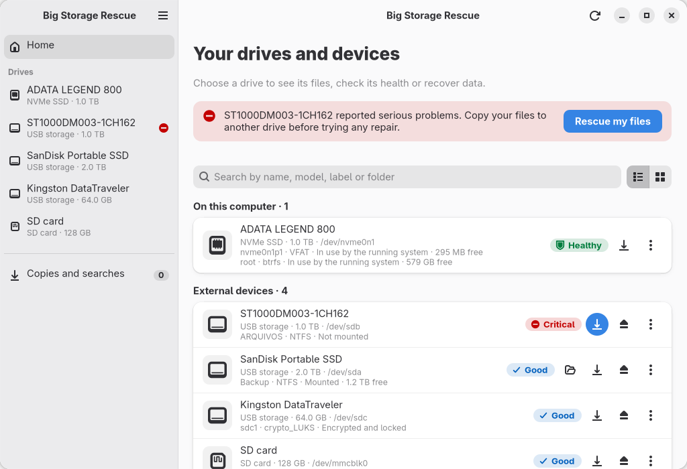
  </picture>
</p>

---

## Contents

- [Highlights](#highlights)
- [Screenshots](#screenshots)
- [Installation](#installation)
- [Getting started](#getting-started)
- [Rescue files, step by step](#rescue-files-step-by-step)
- [Health of a drive](#health-of-a-drive)
- [The running system](#the-running-system)
- [Why can't I write here?](#why-cant-i-write-here)
- [Busy devices and safe removal](#busy-devices-and-safe-removal)
- [The terminal](#the-terminal)
- [Big-Mount and Big Storage Rescue](#big-mount-and-big-storage-rescue)
- [Safety](#safety)
- [Troubleshooting](#troubleshooting)
- [Development](#development)
- [Known limitations](#known-limitations)
- [Documentation](#documentation)
- [License](#license)

## Highlights

| | |
| --- | --- |
| 🗂️ **Every drive at a glance** | internal and external, mounted or not: NVMe, SATA, USB, SD, eMMC, disk images, LUKS and LVM, each with its health in one word (*Critical, Poor, Good, Healthy*) and the facts behind it |
| 🩺 **Health** | SMART and NVMe health (temperature, hours, wear, errors, the last self-test), the kernel log of this boot and of earlier ones (internal drives) and the error counters of Btrfs and ext4, all read without touching the disk |
| 💻 **The running system** | checked on the drive the computer started from only: a full system, Btrfs without room to grow, partitions os-prober left mounted |
| 🔒 **Why can't I write here?** | Windows Fast Startup, filesystem errors, write-protected cards, permissions, another operating system… explained in plain words, and fixed when that is safe |
| ⏏️ **Busy devices and safe removal** | which programs keep a device busy, and what else does (another mount, swap, a container, a service); then unmount, lock encrypted volumes and power off, without forcing anything |
| 🛟 **Rescue files** | copies files off a failing disk with real progress, pause and resume (also after a power cut), and a check of the result |
| 🔎 **When files cannot be reached** | a disk image with GNU ddrescue, lost partitions with TestDisk, files by content with PhotoRec |
| 📄 **Reports** | technical reports of a drive or of a copy, anonymized on request |

What it never does to the drive it rescues from: format it, repair it, rewrite
its partition table, force an unmount or kill programs. See [Safety](#safety).

## Screenshots

The pictures are of the real window, drawn from sample drives
(`tests/readme-screenshots.py`), so they never show anyone's disks or files.
On GitHub they follow your light or dark theme.

<table>
  <tr>
    <td width="50%" align="center">
      <picture>
        <source media="(prefers-color-scheme: dark)" srcset="docs/images/app-health-dark.png">
        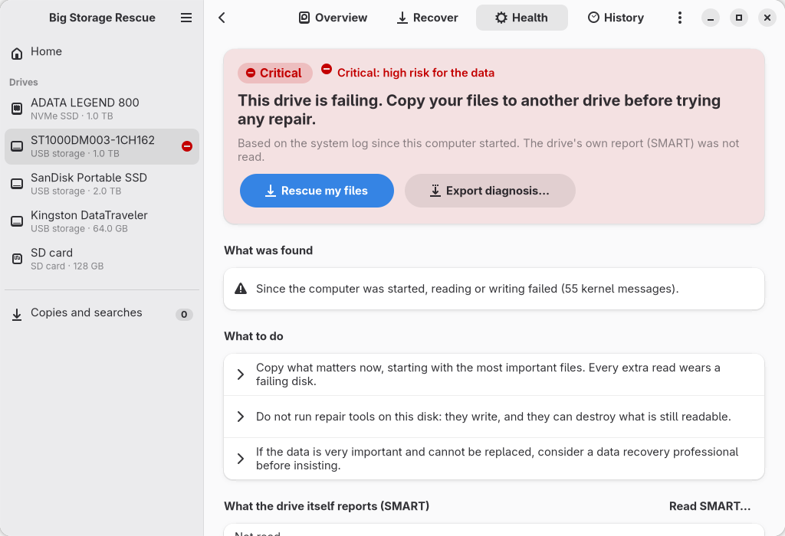
      </picture>
      <br><sub><b>A failing disk</b>: what was found, and what to do</sub>
    </td>
    <td width="50%" align="center">
      <picture>
        <source media="(prefers-color-scheme: dark)" srcset="docs/images/app-health-system-dark.png">
        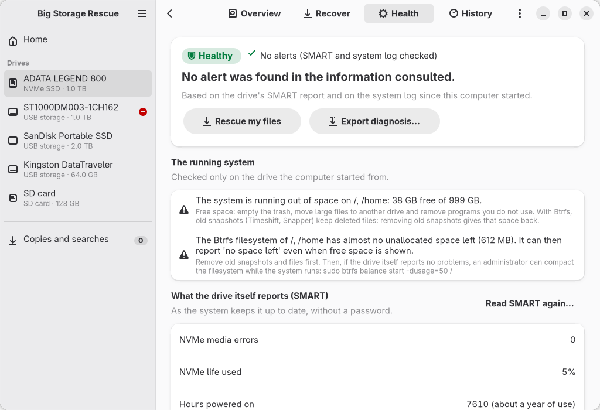
      </picture>
      <br><sub><b>The system drive</b>: healthy, but the system is running out of room</sub>
    </td>
  </tr>
  <tr>
    <td align="center">
      <picture>
        <source media="(prefers-color-scheme: dark)" srcset="docs/images/app-rescue-how-dark.png">
        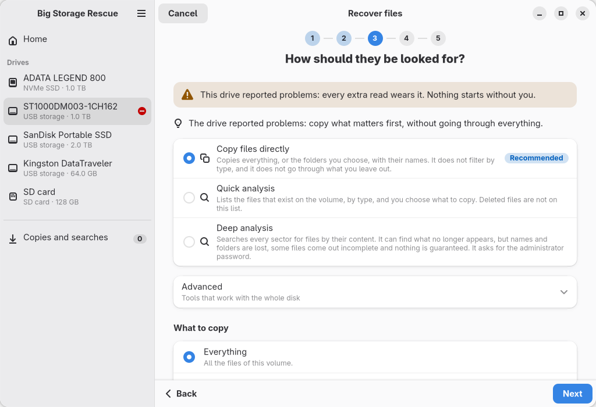
      </picture>
      <br><sub><b>Recover files</b>: the advised way first, with why</sub>
    </td>
    <td align="center">
      <picture>
        <source media="(prefers-color-scheme: dark)" srcset="docs/images/app-rescue-where-dark.png">
        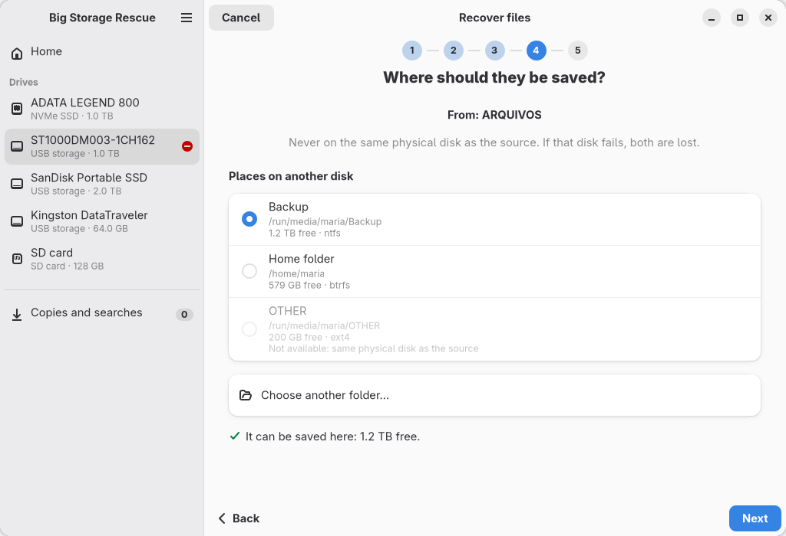
      </picture>
      <br><sub><b>Where to</b>: never the same physical disk</sub>
    </td>
  </tr>
  <tr>
    <td align="center">
      <picture>
        <source media="(prefers-color-scheme: dark)" srcset="docs/images/app-job-running-dark.png">
        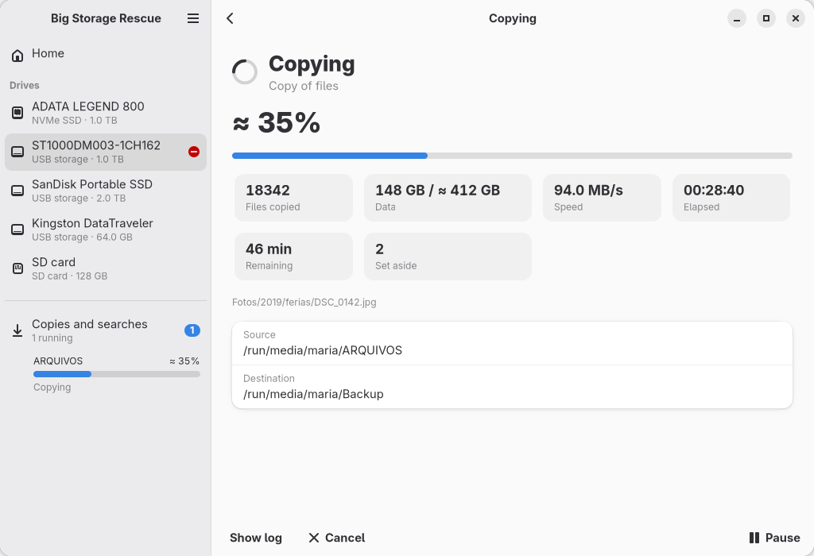
      </picture>
      <br><sub><b>A copy in progress</b>, with real numbers</sub>
    </td>
    <td align="center">
      <picture>
        <source media="(prefers-color-scheme: dark)" srcset="docs/images/app-results-dark.png">
        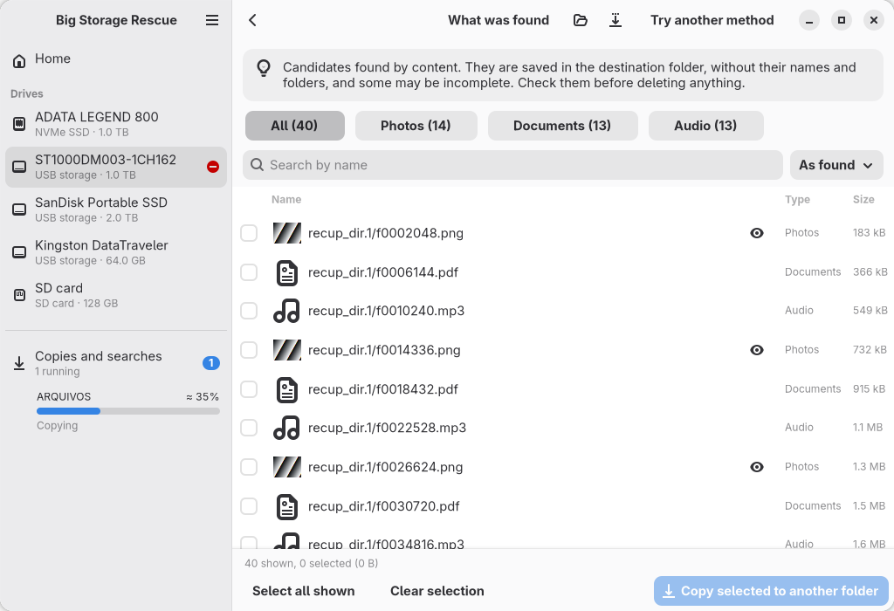
      </picture>
      <br><sub><b>Results</b> of a search by content</sub>
    </td>
  </tr>
  <tr>
    <td align="center">
      <picture>
        <source media="(prefers-color-scheme: dark)" srcset="docs/images/app-overview-grid-dark.png">
        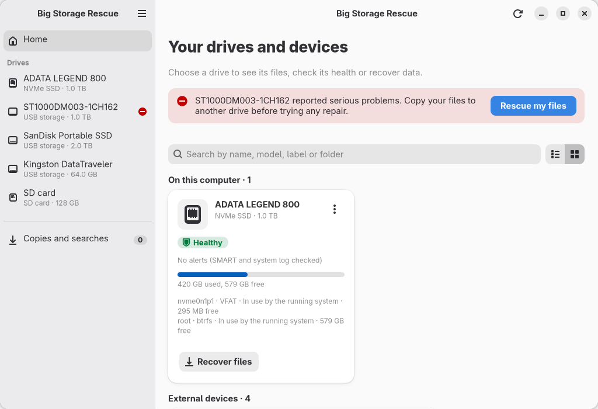
      </picture>
      <br><sub><b>Home</b> as a grid</sub>
    </td>
    <td align="center">
      <picture>
        <source media="(prefers-color-scheme: dark)" srcset="docs/images/app-dialog-read-only-dark.png">
        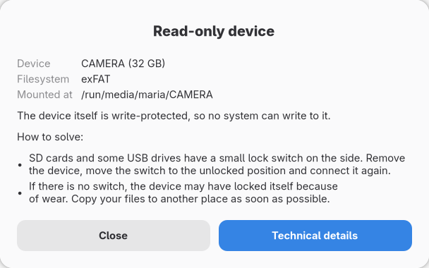
      </picture>
      <br><sub><b>Why can't I write here?</b> from Dolphin</sub>
    </td>
  </tr>
</table>

<details>
<summary>More pictures</summary>

| | |
| --- | --- |
| 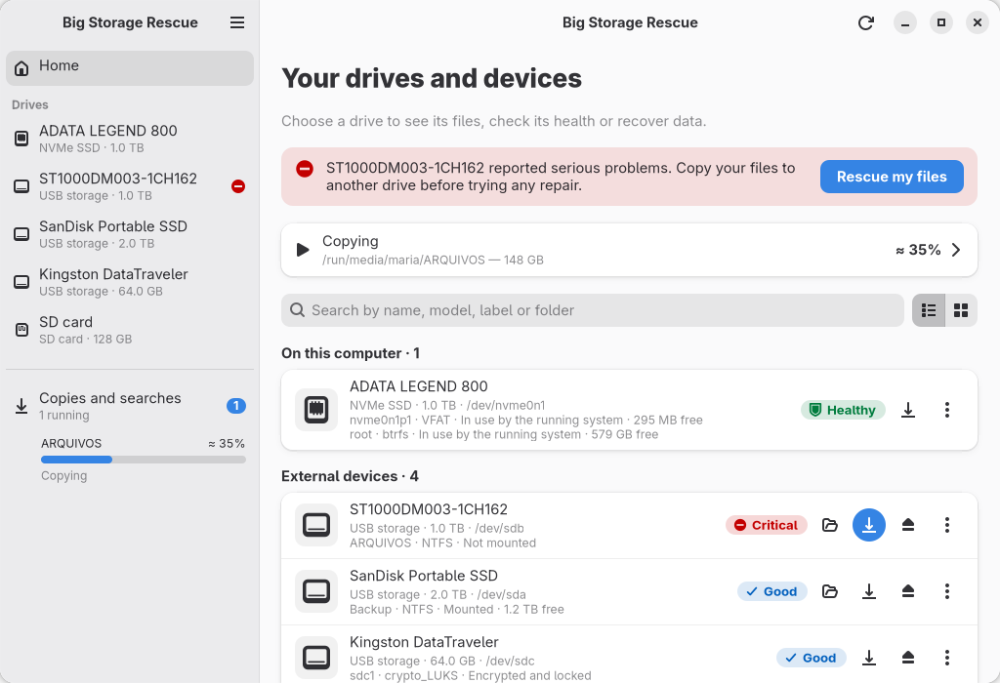 | 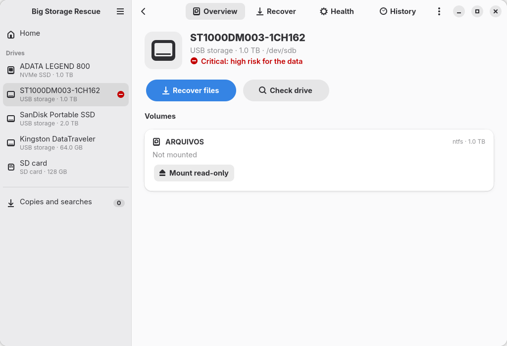 |
| 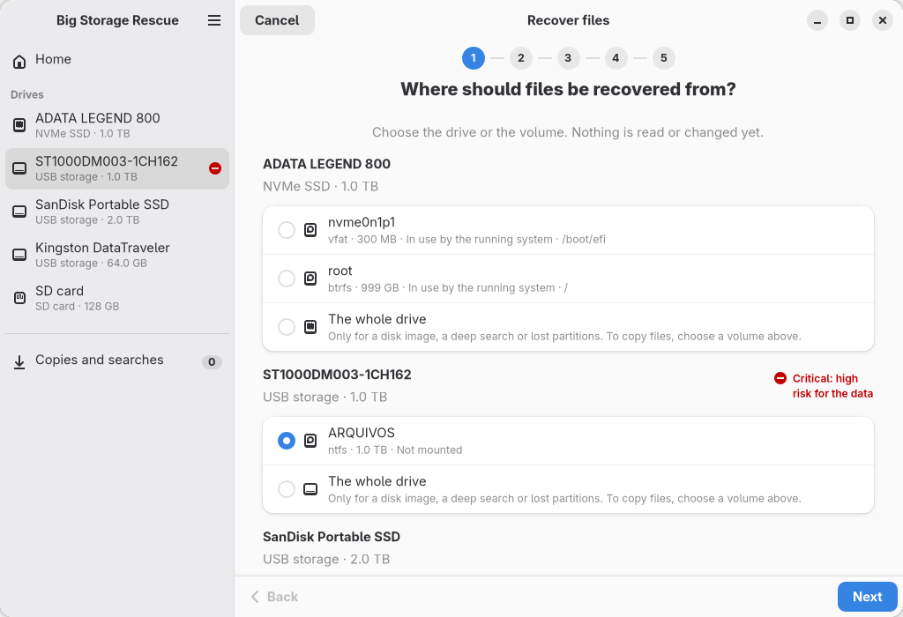 | 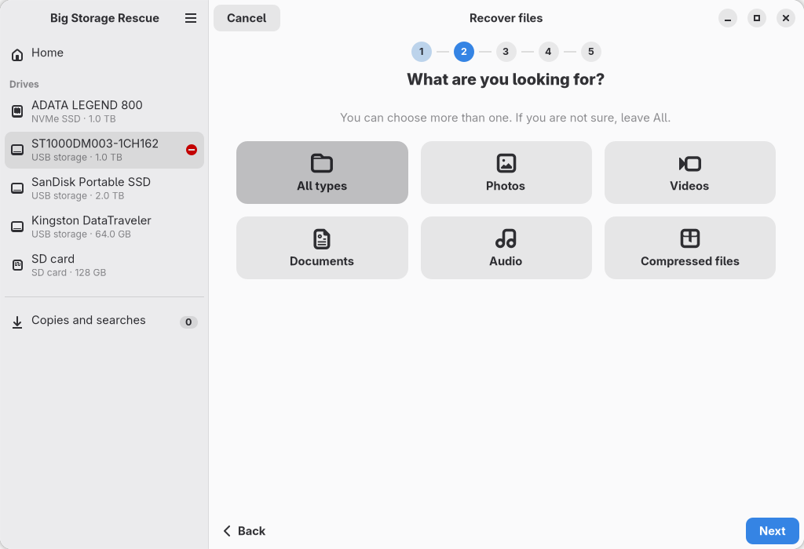 |
| 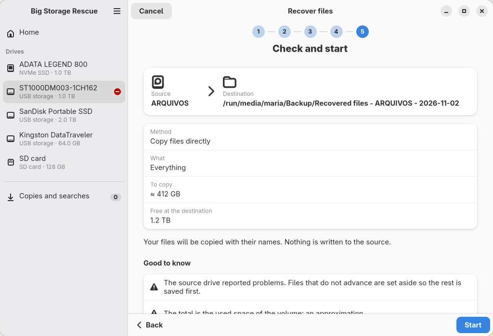 | 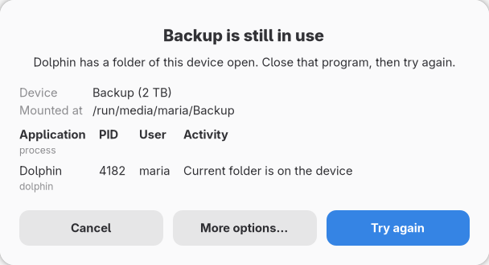 |
| 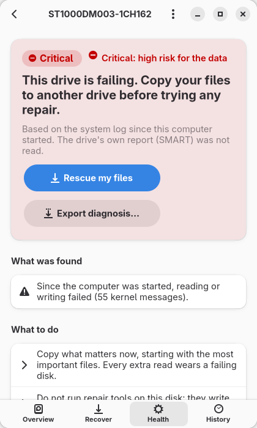 |  |

</details>

## Installation

### From the BigLinux repository

```bash
sudo pacman -Syu big-storage-rescue
```

### Build the package yourself

```bash
git clone https://github.com/biglinux/big-storage-rescue.git
cd big-storage-rescue/pkgbuild && makepkg -si
```

To try changes that are not committed yet, build from your checkout instead:
`pkgbuild/build-local.sh -si`. It uses the same PKGBUILD, downloads nothing,
and `big-storage-rescue --version` then shows the revision with `-dirty`
([docs/14](docs/14-packaging.md)).

Nothing runs at boot and nothing is enabled: the application opens when you
open it.

### Dependencies

pacman installs these with the package:

| Package | Used for |
| --- | --- |
| `bash`, `util-linux` | the engine; `lsblk`, `findmnt`, `blkid`, `flock`, `setpriv`, `setsid`, `ionice` |
| `udisks2`, `glib2` | mounting, unmounting and powering drives off as the user (`udisksctl`, `gdbus`) |
| `polkit` | the administrator password for the two small helpers (`pkexec`) |
| `lsof` | which programs keep a device busy |
| `rsync` | every copy of files |
| `smartmontools` | the health of a drive (`smartctl`) |
| `diffutils` | keeping the map of a disk image safe (`cmp`) |
| `python`, `python-gobject`, `gtk4`, `libadwaita` ≥ 1.5, `pango`, `gdk-pixbuf2`, `hicolor-icon-theme` | the application and its dialogs |
| `libnotify` | notifications (`notify-send`) |

Optional, used when present:

| Package | Adds |
| --- | --- |
| `ddrescue` | disk images of a failing drive, before a deep analysis |
| `testdisk` | lost partitions (TestDisk) and files by content (PhotoRec) |
| `dolphin` | the **Storage device** actions of the right-click menu |
| `big-mount` | mounting the internal partitions at boot |

### Coming from Big-Mount 2.x

The drive manager of Big-Mount 2.x is now this application. Copies and images
started there, the preferences of the window and the read-only notifier are
brought over the first time Big Storage Rescue opens. The originals stay in
`~/.local/state/big-mount` as a backup, and a paused copy resumes here with
what it already wrote. A job that is still running in Big-Mount is left alone
and brought over when it ends. To see what would happen:
`big-storage-rescue --migrate-state --dry-run`.

### Uninstall

```bash
sudo pacman -R big-storage-rescue
```

Your jobs and preferences stay in `~/.local/state/big-storage-rescue` and
`~/.config/big-storage-rescue` until you delete them.

## Getting started

| From | How |
| --- | --- |
| The menu | **Big Storage Rescue** |
| Dolphin | right-click a folder → **Storage device** → *Why can't I write here?*, *Safely remove*, *Check the health of this drive*, *Recover files from this drive…*, *Open in Big Storage Rescue* |
| A terminal | `big-storage-rescue` (the window in a graphical session, menus otherwise) |
| SSH | `big-storage-rescue --cli` |

## Rescue files, step by step

**1. Look at the drive.** Home lists every drive with its health in one word
and an icon, never by colour alone. A drive that was not examined is never
shown as *no alerts*.

**2. Recover files** opens an assistant: *from where → what → how → where to →
confirm*, and going back loses nothing. The way advised first depends on the
drive:

| The drive | Advised first |
| --- | --- |
| a healthy volume | a list of the files, to choose from |
| a drive at risk | a copy of what matters, without walking the whole disk |
| a volume that cannot be opened | a disk image first, then a search in the image |

**3. Follow the job.** It runs in the background, with or without the window,
and shows the current file, files and bytes, speed, elapsed and remaining
time, and files that failed or were set aside. Pause and resume are shown only
for the jobs that support them.

**4. Results.** Four words that never mean the same thing:

| Word | Meaning |
| --- | --- |
| **Found** | a file listed on the volume |
| **Candidate** | a file PhotoRec rebuilt from its content: no name, maybe incomplete |
| **Recovered** | a file written to the destination and synced |
| **Verified** | a recovered file compared with the source, and equal |

## Health of a drive

Health is read, never tested: no self-test is started, no sector is read on
purpose.

| Source | What it tells |
| --- | --- |
| SMART / NVMe health | the drive's own report: reallocated and pending sectors, wear, temperature, hours, the result of the last self-test |
| The kernel log of this boot | read errors, timeouts, resets, a link that slowed down |
| The kernel log of earlier boots | the same, for internal drives, when the drive on that port is the same model and firmware (or the same PCI address) as now |
| Btrfs and ext4 error counters | errors the filesystem recorded, which survive a restart |

| Grade | Meaning |
| --- | --- |
| **Critical** | failing now: copy your files before anything else |
| **Poor** | something is not right, or the flash is worn out: copy what matters |
| **Good** | no alert, but with a note: SMART could not be read, wear, many hours, heat, or SMART values that were low in the past |
| **Healthy** | no alert and no note, with the drive's own report (SMART) read |
| **Not assessed** | nothing could be read yet: never shown as "no alerts" |
| **Not applicable** | a disk image, which has no health of its own |

Errors that happened only in earlier boots are shown in the window but not
announced at every login. Details: [docs/05](docs/05-readonly-diagnostics.md),
[docs/18](docs/18-system-and-history-checks.md).

## The running system

Some checks only mean something for the drive the computer started from. A
full USB stick is its owner's business, not a fault. So these checks are made
**only on the system drive**:

| Check | Where | Why there |
| --- | --- | --- |
| Free space of `/`, `/home`, `/boot`, `/var`… | the system drive | a full system breaks updates and loses settings; `/boot` without room breaks a kernel update |
| Btrfs unallocated space and metadata | the system drive | Btrfs can say "no space left" while free space is still shown |
| Partitions os-prober left mounted | whichever drive holds the partition | that partition cannot be removed or checked until it is released |
| Errors in earlier boots | internal drives | USB ports and `sdX` names are reused by other drives |
| Filesystem error counters | any mounted Btrfs or ext4 | they are stored on the drive itself |

What to do is explained. What needs an administrator (`btrfs balance`,
`umount`) is shown as a command to read, never run from here. The checks came
from a review of a general BigLinux diagnosis script; what was taken and what
was left out, and why, is in [docs/18](docs/18-system-and-history-checks.md).

## Why can't I write here?

```bash
big-storage-rescue --diagnose /run/media/me/PENDRIVE
```

Or Dolphin → **Storage device** → **Why can't I write here?**. A damaged drive
is never presented as a simple restriction, and a restriction is never
presented as damage: the diagnosis checks the hardware and the kernel log
before permissions. Details: [docs/05](docs/05-readonly-diagnostics.md).

## Busy devices and safe removal

```bash
big-storage-rescue --busy /run/media/me/PENDRIVE
big-storage-rescue --safe-remove /run/media/me/PENDRIVE [--close-apps]
```

The programs keeping a device busy are named, with what they are doing.
Closing them is offered only for your own programs that are not writing, and
only after you confirm. Services that would stop are listed first. Internal
disks are unmounted, never powered off. Details:
[docs/06](docs/06-busy-processes.md), [docs/07](docs/07-safe-removal.md).

## The terminal

```bash
big-storage-rescue --cli                 # menus, in any terminal
big-storage-rescue --cli --help          # every command
big-storage-rescue --cli list --json     # for scripts
big-storage-rescue --cli diagnose /dev/sdb
big-storage-rescue --doctor              # check the installation and the storage stack
```

Every operation of the window is a command, and the window uses those same
commands, so they always agree. `--json` gives stable machine-readable output,
and `--dry-run` says what would be done. Exit codes and examples:
[docs/11](docs/11-cli.md).

| Option | |
| --- | --- |
| *(none)* | the application in a graphical session, the menus in a terminal |
| `--gui [TARGET]`, `--gui-health`, `--gui-rescue` | the application, opened on a drive, its health or the recovery |
| `--cli [COMMAND]` | the drive manager |
| `--diagnose [TARGET]`, `--busy`, `--unmount`, `--safe-remove` | diagnosis and removal |
| `--gui-diagnose`, `--gui-remove` | the Dolphin actions |
| `--notifier` | warns about read-only devices (off by default; turn it on in the menu) |
| `--migrate-state [--dry-run]` | bring over the state of Big-Mount 2.x |
| `--doctor`, `--version`, `--help` | |

<details>
<summary>What <code>--doctor</code> looks like</summary>

```text
Big Storage Rescue check (nothing is changed; labels, serial numbers, UUIDs and personal paths are left out)

Big Storage Rescue
  [INFO] Big Storage Rescue 1.0.0, 1a2b3c4 (2026-11-02T10:00:00Z)
  [ OK ] Installed files match the package

Desktop session
  [ OK ] Drive manager, copying files off a drive: rsync
  [ OK ] Drive manager, SMART details: smartctl
  [ OK ] Drive manager, disk images: ddrescue
  [ OK ] Application and dialogs: GTK 4 and libadwaita

Storage stack
  [ OK ] UDisks2 answers on the system D-Bus
  [ OK ] Polkit knows the action of Big Storage Rescue
  [ OK ] nvme0n1: nvme, 1 TB, internal
  [WARN] sdb: the drive reports problems (timeouts io-errors)
         For details: big-storage-rescue --diagnose /dev/sdb

Running system
  [ OK ] Enough free space, and nothing left mounted by os-prober

Result: 0 problem(s), 1 warning(s).
To report a problem, attach this output: big-storage-rescue --doctor > big-storage-rescue-report.txt
```

</details>

## Big-Mount and Big Storage Rescue

| | Big-Mount | Big Storage Rescue |
| --- | --- | --- |
| Mounts internal partitions at boot | yes | no |
| Runs at boot | yes, `big-mount.service` | never |
| Diagnosis, busy devices, safe removal, health, rescue | no | yes |
| Graphical interface | no | yes |

They are independent packages: you can install both, either one, or neither,
without file conflicts. When Big-Mount is present, Big Storage Rescue reads
what it left in `/run/big-mount/status` to explain why a partition was
mounted read-only at boot, and shows its state in `--doctor`. It never
changes Big-Mount's configuration or restarts its service.

## Safety

- It runs as your user. Anything that needs more goes through UDisks2 and
  polkit, or through two small helpers run by pkexec with the administrator
  password. There is no daemon, and nothing stays running.
  [docs/12](docs/12-security.md)
- A drive at risk is mounted read-only, and can be blocked at the device level.
- Destination checks: never inside the source, never on the same physical disk
  (through partitions, LUKS and LVM) unless you insist in the terminal, enough
  room, existing files kept.
- Device names are never trusted across time: the disk sequence number is
  checked before every operation that cannot be undone.
- A mount that hangs (FUSE on a failing disk, a share that went away) does not
  hang the program: the questions that could block have a time limit.
- Secure Erase, formatting and repairs are not part of this tool.
- When the hardware itself is failing (heads, controller, firmware, NAND), no
  software can fix it. If the data is very important, stop and consider a
  data recovery professional before trying again.

## Troubleshooting

| Problem | What to do |
| --- | --- |
| Something does not work as described | `big-storage-rescue --doctor` checks the installation, the session and the storage stack; attach its output to a report |
| A drive says *Not assessed* | nothing could be read yet: open its **Health** page and read SMART |
| Home says *a mounted device did not answer in time* | a mounted volume hangs (often a failing disk, or FUSE over one): every drive is still listed, without free space, after a few seconds |
| `--doctor` says the menu entry was changed | on BigLinux, *render-menu-options* adds the graphics card options to every menu entry: expected |
| Nothing happens when asked for the password | a polkit agent must be running in your session (Plasma and GNOME have one) |

## Development

```text
big-storage-rescue/usr/bin/big-storage-rescue    entry point
big-storage-rescue/usr/lib/big-storage-rescue/   engine (bash) and application (Python, GTK 4)
locale/                                          gettext catalog, templates
pkgbuild/                                        PKGBUILD, build-local.sh
tests/                                           test suites
docs/                                            technical documentation (01–18)
```

Run it from the checkout without installing:

```bash
BSR_LIB=$PWD/big-storage-rescue/usr/lib/big-storage-rescue bash big-storage-rescue/usr/bin/big-storage-rescue --doctor
```

Tests (no test touches a real disk):

```bash
bash tests/lib-tests.sh        # diagnosis, process policy, health, the running system
bash tests/drive-tests.sh      # drive manager with fixtures, real jobs on scratch files
bash tests/migrate-tests.sh    # state of Big-Mount 2.x, a real resume
bash tests/i18n-tests.sh       # translations
bash tests/package-check.sh    # package() on this checkout
python3 tests/gui-tests.py     # the window, on a private Broadway display
python3 tests/gui-e2e.py       # the window with the real engine, on scratch files
```

`tests/integration.sh` and `tests/drive-integration.sh` use real loop devices
and need a local session with UDisks2.

The pictures of this README:

```bash
LC_ALL=C.UTF-8 python3 tests/readme-screenshots.py
LC_ALL=C.UTF-8 python3 tests/readme-screenshots.py --dark
```

Translations: `locale/update-pot.sh`, translate, `locale/compile.sh`
([docs/13](docs/13-i18n.md)). Architecture and decisions:
[docs/03](docs/03-architecture.md). The history of the code, from Big-Mount
2.0 to 2.6, is kept in git and in [docs/big-mount-history](docs/big-mount-history).

## Known limitations

- Resuming works per file: a large file that was interrupted starts over. A
  file with read errors is not saved in part; a disk image keeps what can be
  read.
- `--protect` lasts until the drive is disconnected. Clicking a failing disk in
  Dolphin mounts it with writing enabled before this program can protect it:
  that is the policy of UDisks2 and the desktop.
- XFS and Btrfs with an unclean log cannot be mounted through UDisks2 without
  replaying it.
- The first read of a damaged area can take minutes, and `cancel` waits for it.
- Owners are not preserved: a copy does not run as root. A file of 4 GiB or
  more cannot go to FAT32 and is listed as failed.
- As a user, only your own processes are listed; the others need the password.
- Plasma does not let other programs add actions to its own unmount error: the
  diagnosis lives in the Dolphin menu, the launcher and the terminal.
- Not validated on real hardware by this project yet: the password dialog of
  the helper, LVM, RAID, multi-device Btrfs, SD and eMMC (detected from
  fixtures), a screen reader, a real GNOME session. GNU ddrescue was run for
  real only by Big-Mount 2.6 in the field, not by the tests.

## Documentation

| | | |
| --- | --- | --- |
| [01 Source audit](docs/01-source-audit.md) | [07 Safe removal](docs/07-safe-removal.md) | [13 Translations](docs/13-i18n.md) |
| [02 Migration plan](docs/02-migration-plan.md) | [08 Recovery engine](docs/08-recovery-engine.md) | [14 Packaging](docs/14-packaging.md) |
| [03 Architecture](docs/03-architecture.md) | [09 Copy and resume](docs/09-copy-and-resume.md) | [15 Testing](docs/15-testing.md) |
| [04 Device detection](docs/04-device-detection.md) | [10 GTK and Libadwaita](docs/10-gtk-libadwaita-ux.md) | [16 Migration validation](docs/16-migration-validation.md) |
| [05 Read-only diagnostics](docs/05-readonly-diagnostics.md) | [11 Command line](docs/11-cli.md) | [17 Final report](docs/17-final-report.md) |
| [06 Busy processes](docs/06-busy-processes.md) | [12 Security](docs/12-security.md) | [18 System and history checks](docs/18-system-and-history-checks.md) |

## License

[GNU General Public License v3.0 or later](LICENSE). Big Storage Rescue started
from the code of Big-Mount, by the BigLinux team; the full history and
authorship are in git.
